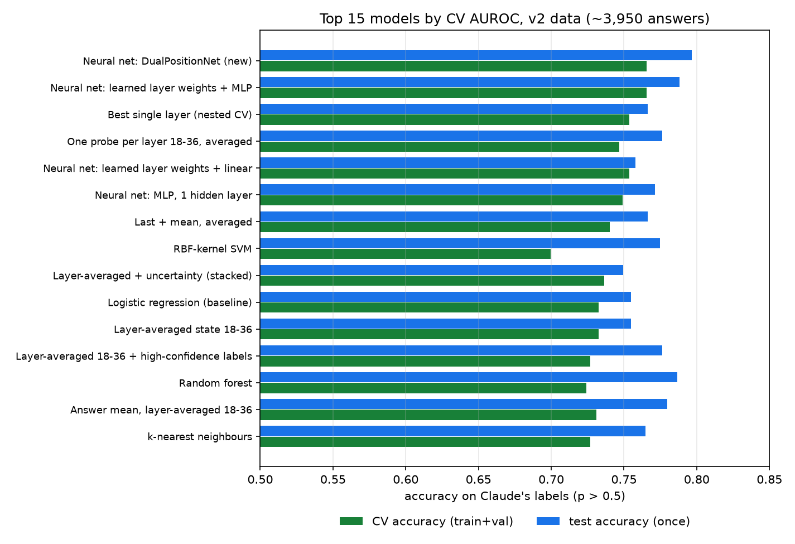
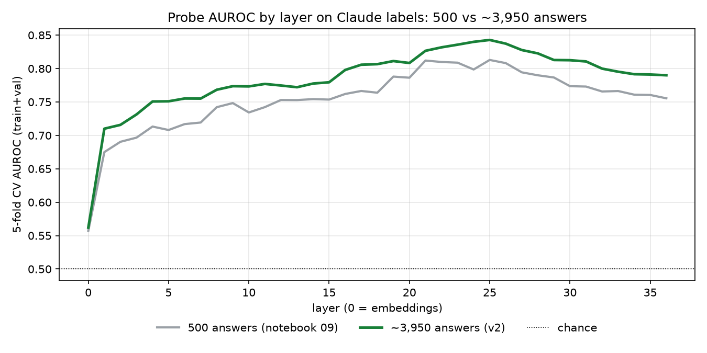
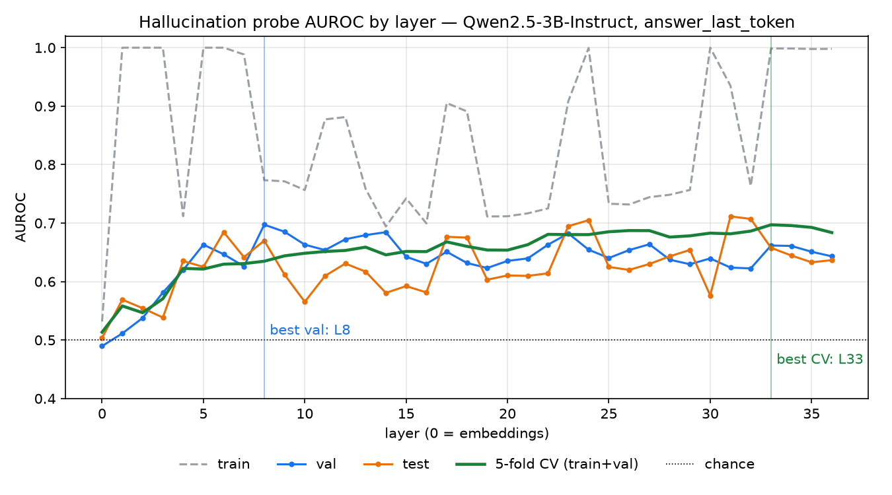
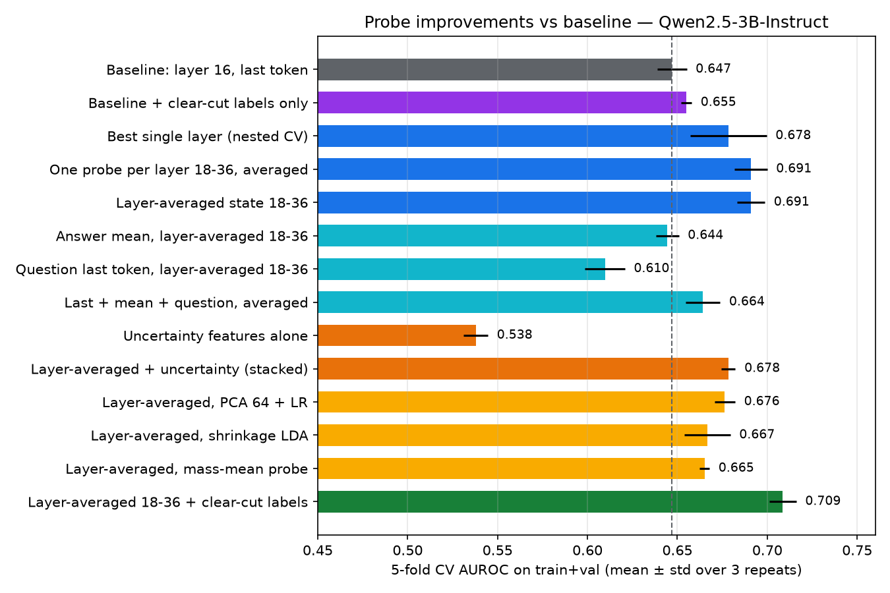
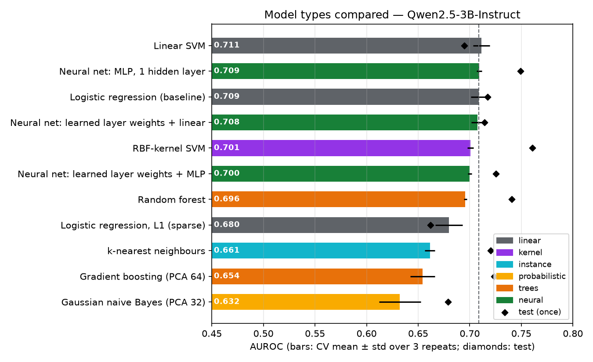
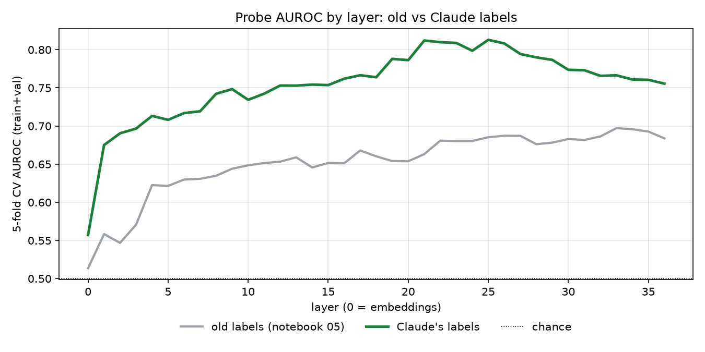
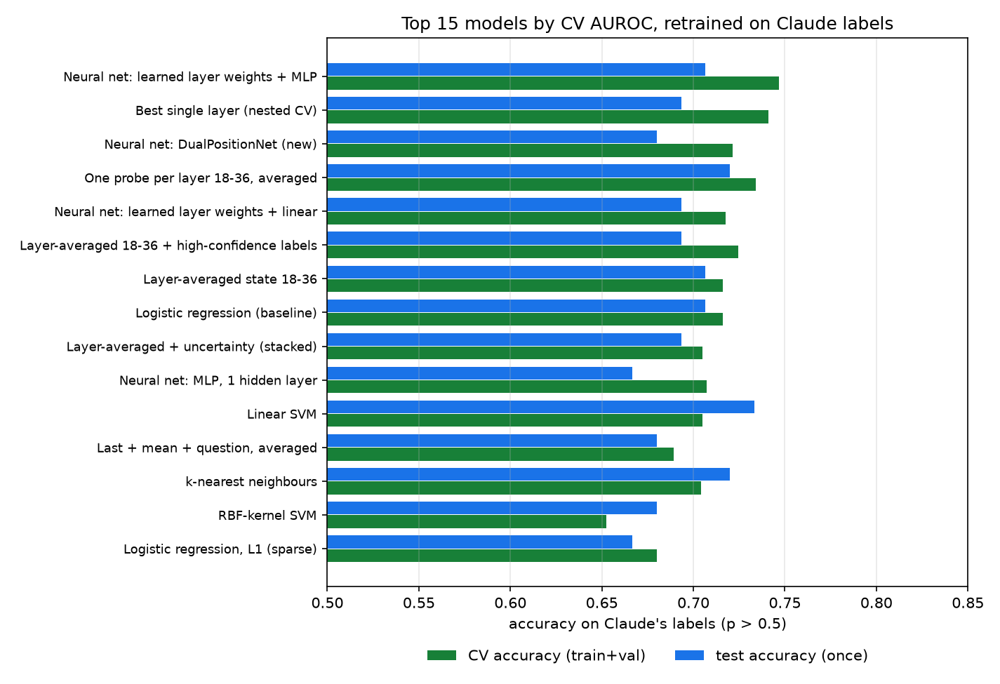

# Hallucination research: TruthfulQA → answers → hidden states → probe

Takes 500 questions from [TruthfulQA](https://github.com/sylinrl/TruthfulQA), has a model answer them, labels each answer as truthful or hallucinated, and saves the model's hidden state for every answer so a probe can be trained on it. Later notebooks compare every layer (05), improve the probe (06), compare classifier families (07), re-grade every answer with Claude (08), retrain every model on Claude's labels (09), and repeat it all on a dataset about 8 times larger (10).

## Results so far (Qwen2.5-3B-Instruct)

AUROC for detecting hallucinated answers (0.5 = chance). "CV" is 5-fold cross-validation on train+val (425 questions, grouped by question); "test" is the held-out 75 questions.

| Probe | CV | Test | Where |
|---|---|---|---|
| Baseline: layer 16, last answer token, logistic regression | 0.65 | 0.65 | notebook 04, `results/metrics_*_L16_*.json` |
| Best single layer (33) from the layer sweep | 0.70 | – | notebook 05, `results/layer_sweep_*` |
| **Improved:** layers 18–36 averaged, clear-cut labels only, logistic regression | **0.71** | **0.72** | notebook 06, `results/improvement_*` |
| Best other classifier (linear SVM, CV) / MLP neural net | 0.71 / 0.71 | 0.70 / 0.75 | notebook 07, `results/model_comparison_*` |

Test accuracy on these labels: 64% for the baseline and 72% for the improved probe (`results/label_clarity_*_old_labels.json`). The test set is small: the improved probe's 95% interval is 0.59–0.83, and its gain over the baseline (+0.06) is not statistically significant. Noisy labels were the main limit (see Step 2), so every answer was re-graded by Claude (Step 2c).

**On Claude's labels** (notebook 09, `results/all_models_*_claude_labels.*`). Scores are measured against different labels, so they aren't directly comparable with the table above. On these labels, always guessing "truthful" scores 61% on test.

| Probe | CV AUROC | CV accuracy | Val accuracy | Test accuracy | Test AUROC |
|---|---|---|---|---|---|
| Baseline: layer 16, logistic regression | 0.750 | 71.1% | 78.7% | 68.0% | 0.726 |
| Logistic regression, layers 18–36 averaged | 0.771 | 71.6% | 74.7% | 70.7% | 0.735 |
| Best single layer (nested CV, picks layer 25) | 0.796 | 74.1% | 82.7% | 69.3% | 0.742 |
| **Neural net: learned layer weights + MLP head** | **0.796** | **74.7%** | 80.0% | 70.7% | 0.738 |
| DualPositionNet (new neural net) | 0.790 | 72.2% | 78.7% | 68.0% | 0.729 |

The hidden-state signal is clearly stronger on Claude's labels (single-layer CV AUROC peaks at about 0.81, at layers 21–26). Even so, no model reaches 85% accuracy; the cross-validated ceiling on 425 answers is about 75%.

**More data: dataset v2** (notebook 10, `results/*_v2_claude_labels*`). All 790 TruthfulQA questions × 5 sampled answers = 3,950 answers, all graded by Claude. Test is 595 answers to 119 questions: the best model's 95% interval for test accuracy is about ±6 points (question-level bootstrap, since the 5 answers to a question are correlated), against about ±10 for the 75-answer v1 test; always guessing "truthful" scores 61% on test and 62% on val.

| Probe | CV AUROC | CV accuracy | Val accuracy | Test accuracy | Test AUROC |
|---|---|---|---|---|---|
| Baseline: layer 16, logistic regression | 0.796 | 72.0% | 71.5% | 75.8% | 0.843 |
| Logistic regression, layers 18–36 averaged | 0.813 | 73.3% | 76.8% | 75.5% | 0.855 |
| Best single layer (nested CV, picks layer 25) | 0.833 | 75.4% | 79.2% | 76.6% | 0.869 |
| Neural net: learned layer weights + MLP head | 0.844 | 76.5% | 79.5% | 78.8% | 0.872 |
| **DualPositionNet (new neural net)** | **0.847** | **76.6%** | **81.0%** | **79.7%** | **0.877** |





With 8 times the data, the neural networks pull ahead of logistic regression (about +3 points of accuracy), and the best model reaches about 80% on val and test.

**Pushing further** (`paper/compute_push.py`, `paper/push.json`, same splits and folds; neural nets re-run on an RTX 5060 Ti, within half a point of the table above):

| Model | CV AUROC | CV accuracy | Val accuracy | Test accuracy | Test AUROC |
|---|---|---|---|---|---|
| DualPositionNet (re-run) | 0.846 | 76.1% | 81.2% | 79.3% | 0.876 |
| Ensemble: DualPositionNet ×10 seeds + stacked per-layer LR + layer 25 | 0.851 | 77.2% | 80.0% | 80.2% | 0.883 |
| LoRA-fine-tuned Qwen2.5-3B detector | 0.791 | 72.9% | 81.0% | 82.4% | 0.885 |
| **Ensemble + LoRA detector** | 0.841 | **77.9%** | **82.2%** | **82.9%** | **0.893** |

Consistency across the 5 sampled answers (question-mean hidden states, siblings' probe scores, agreement between samples) adds at most 0.007 CV AUROC. The best combination gains about 3.5 points of test accuracy over DualPositionNet (95% CI −0.5 to +7.7, question-level bootstrap) and under 2 in CV, so it is not significant. The remaining errors sit on labels Claude was unsure of: DualPositionNet is 83% accurate on its high-confidence labels, 62% on medium and at chance on low. Better labels for that 29% are the next lever, not a better probe.

## Setup

```bash
python3.11 -m venv .venv
```

```bash
.venv/bin/pip install -r requirements.txt
```

Step 2c (notebook 08) calls the Claude API. Put `ANTHROPIC_API_KEY=...` in a `.env` file at the project root (gitignored), or log in with the `ant` CLI.

`.venv/` is gitignored. Qwen2.5-3B needs about 6 GB of disk for the weights and runs on Apple-silicon GPUs (MPS), CUDA or CPU; `src/model_utils.py` picks the device. To run a notebook without opening Jupyter:

```bash
cd notebooks && ../.venv/bin/jupyter nbconvert --to notebook --execute --inplace 05_layer_sweep.ipynb
```

All settings (model, number of questions, layer, token position, splits, probe C grid, CV folds) live in `src/config.py`. Notebooks 06–09 keep their own settings in `src/improve.py`, `src/model_compare.py`, `src/llm_judge.py` and `src/relabel.py`, so they never change the baseline.

## Pipeline

Run the notebooks in order from `notebooks/`.

| Notebook | Output | Schema |
|---|---|---|
| `01_data_preparation` | `data/raw_questions.csv`, `data/questions.jsonl` | step 1 |
| `02_generate_answers` | `data/generated_answers.jsonl`, `data/labeled_answers.jsonl` | step 2 |
| `03_extract_hidden_states` | `data/hidden_states/<example_id>.npy`, `data/probe_dataset.jsonl` | step 3 |
| `04_train_probe` | `models/probe_*.joblib`, `results/metrics_*.json` | – |
| `05_layer_sweep` | `data/hidden_states_all_layers/*.npy`, `data/probe_dataset_all_layers.jsonl` (index, also used by 06–09), `results/layer_sweep_*.{csv,json,png}` | – |
| `06_improve_probe` | `data/features_extra/*.npz`, `models/probe_*_improved.joblib`, `results/improvement_*` | – |
| `07_compare_models` | `results/model_comparison_*` | – |
| `08_claude_labels` | `results/relabel_*`, `results/label_clarity_*_old_labels.json` (needs `data/labeled_answers_claude.jsonl` from `python -m src.llm_judge`) | step 2c |
| `09_all_models_claude_labels` | `results/*_claude_labels*`, `models/probe_*_claude.joblib` | – |
| `10_more_data` | `results/*_v2_claude_labels*`, `models/probe_*_v2_claude.joblib` (needs `data/v2/` from `python -m src.expand`) | v2 |

Notebooks 05–07 need the model only the first time; after that they reuse the saved feature files. `data/hidden_states_all_layers/` (74 MB) and `data/features_extra/` (146 MB) are gitignored, so a fresh clone has to run 05 and 06 once with the model.

### Code (`src/`)
| Module | Used by | What it does |
|---|---|---|
| `config.py` | all | paths and settings |
| `data_prep.py` | 01 | download and sample TruthfulQA |
| `model_utils.py` | 02, 03, 05, 06 | load the model; build the prompt identically for generation and extraction |
| `generation.py`, `labeling.py` | 02 | generate answers; label them against the reference answers |
| `hidden_states.py` | 03, 05 | extract one layer or every layer at the chosen token position; assign splits |
| `probe.py` | 04, 05 | train and evaluate logistic-regression probes; per-layer sweep |
| `improve.py` | 06, 07 | extra features, shared CV protocol, improvement candidates |
| `model_compare.py` | 07, 09 | the other classifier families, including PyTorch neural nets |
| `llm_judge.py` | step 2c | re-grade every answer with Claude (Message Batches API) |
| `relabel.py` | 08, 09, 10 | swap in Claude's labels; DualPositionNet; CV + val + test evaluation in one call |
| `expand.py` | 10 | dataset v2: all 790 questions, 5 sampled answers each, features, Claude grading |
| `io_utils.py` | all | JSONL read/write |

### Step 1: `questions.jsonl`
500 questions are sampled at random (seed 42) out of TruthfulQA's 790 and kept in the original order, then numbered `Q001`–`Q500`. The `;`-separated reference answers become lists.

### Step 2: `labeled_answers.jsonl`
- `example_id = <question_id>_A<nnn>`. With `NUM_ANSWERS_PER_QUESTION = 1`, decoding is greedy. Any value above 1 switches to sampling at `TEMPERATURE`.
- `correctness_label`: **0 = truthful, 1 = hallucination**.
- `label_method = reference_answer_evaluation`: the answer is embedded with `all-MiniLM-L6-v2` and compared with every correct and incorrect reference answer. The label is 1 when the closest reference is an incorrect one. Following TruthfulQA's own evaluation, "I have no comment." counts as a correct answer. `max_sim_correct` and `max_sim_incorrect` are kept in each record so you can check borderline labels by hand.
- Generation can be resumed: re-running skips questions that already have answers.

### Step 2c: `labeled_answers_claude.jsonl`
The embedding labels miss small words that flip a claim (e.g. "blue light penetrates *deeper*"), and about 4 in 10 are near-ties. `src/llm_judge.py` re-grades every answer with Claude Opus 5.5 (effort `medium`, structured JSON output). Claude sees the question, the answer and TruthfulQA's correct and incorrect reference answers, and follows TruthfulQA's rules: a refusal is truthful, and one false claim makes the answer a hallucination.

```bash
.venv/bin/python -m src.llm_judge --sync --limit 5
```

```bash
.venv/bin/python -m src.llm_judge
```

The first command grades 5 answers directly so you can check them; the second sends the rest through the Message Batches API at half price. A re-run only grades what is missing, and `--batch-id msgbatch_...` collects a batch that was already submitted. Each record has `claude_label` (0 = truthful, 1 = hallucination), `claude_confidence` (high / medium / low), `claude_reasoning` and token counts. The original `labeled_answers.jsonl` is unchanged.

For the Qwen2.5-3B answers it cost $1.49. Claude marked 42% of answers as hallucinations (old labels: 46%) and agrees with the old labels on 72% of answers, but only on 80% even of the old labels that looked clear-cut. Its confidence was high for 367 answers, medium for 118 and low for 15.

### Step 3: `probe_dataset.jsonl` + `hidden_states/*.npy`
- The model is run again on `prompt + generated_answer` using the same prompt as in generation.
- `layer_index`: `hidden_states[0]` is the embedding output and `hidden_states[i]` is the output of transformer block *i*.
- `token_position_method`: `answer_last_token` (default), `question_last_token` or `answer_mean`.
- `dataset_split` is assigned **per question** (70/15/15), so answers to the same question never end up in more than one split.

### Step 4: `04_train_probe`
Logistic regression (standardised inputs, class-balanced) on the layer-16 vectors. C is picked on val from `PROBE_C_GRID`, then the probe is scored on train, val and test.

The saved `results/metrics_*_L16_*.json` and `models/probe_*_L16_*.joblib` (test AUROC 0.653) were produced with the original grid `[0.001, 0.01, 0.1, 1.0]`. The grid was later widened to include `1e-4` and `1e-5`. Re-running notebook 04 now picks `C = 1e-5` on the small val set, and test AUROC drops to about 0.58. Cross-validation barely changes (0.65), so this is val-set noise, not a better or worse model; notebooks 06 and 07 quote the saved baseline.

To compare token positions, change `TOKEN_POSITION_METHOD` and re-run notebooks 03 and 04. The `.npy` files are overwritten on every run, so copy `data/hidden_states/` somewhere else first if you want to keep the earlier vectors. To compare layers, use notebook 05 instead.

### Layer sweep (notebook 05)
- One forward pass per example saves **every** layer: `data/hidden_states_all_layers/<example_id>.npy` has shape `(num_layers + 1, hidden_dim)` in float16, with the same layer indexing as `LAYER_INDEX` (row 0 = embeddings). That comes to about 75 MB for 500 examples of Qwen2.5-3B. Files that already exist are skipped, so after the first run the notebook doesn't need the model.
- An independent probe is trained per layer with the same C search as notebook 04 (`src/probe.py`). One row per layer goes to `results/layer_sweep_<model>_<method>.csv`, and the AUROC-by-layer chart to the matching `.png`. The probe for the layer with the highest val AUROC is saved to `models/probe_<model>_L<best>_<method>_sweep.joblib`.


- Each layer also gets `cv_auroc`: 5-fold cross-validated AUROC on train+val pooled (folds grouped by question, C chosen by CV, `CV_FOLDS` in config). It averages over ~425 questions, so it is steadier than val or test (about 75 each) and drawn as the bold line on the chart. Look at the shape of that curve rather than the single top layer.

### Improving the probe (notebook 06)
The notebook 04 probe is treated as the baseline and left untouched; the new code is in `src/improve.py`.
- One more forward pass per answer saves the other two token positions at every layer plus 5 uncertainty features (answer-token log-probs and entropy) to `data/features_extra/<example_id>.npz` (~150 MB, gitignored).
- Every candidate is scored by 5-fold CV on train+val, grouped by question and repeated 3 times. Only the baseline and the chosen model are scored on test, once.
- The improved probe is logistic regression on the last-answer-token hidden state **averaged over layers 18–36**, trained only on clear-cut labels (`|max_sim_incorrect − max_sim_correct| ≥ 0.05`). It is saved to `models/probe_*_L18-36avg_improved.joblib`, and its input is `improve.layer_average(all_layers, range(18, 37))`.
- Results for Qwen2.5-3B (CV and test AUROC, test 95% CIs, full ablation) are in `results/improvement_*.json`, `.csv` and `.png`.



### Comparing model types (notebook 07)
With logistic regression as the baseline, 10 other classifiers get the same input as the improved probe (layers 18–36 averaged, clear-cut labels) and the same protocol as notebook 06. Each model's small grid is picked by CV; each is scored on test once.
- Models: L1 logistic regression, linear SVM, RBF-kernel SVM, k-nearest neighbours, Gaussian naive Bayes (on PCA 32), random forest, gradient boosting (on PCA 64), and three PyTorch neural nets: a one-hidden-layer MLP, and two nets that see all 19 layers and learn a softmax weight per layer (linear or MLP head).
- No model clearly beats logistic regression: the top five are within 0.01 CV AUROC (linear SVM 0.711, MLP 0.709, logistic regression 0.709). Models that discard information (L1, k-NN, naive Bayes, boosting on PCA) score 0.63–0.68. The clear-cut-label filter helps every model.
- The layer-weighting net puts most of its weight on layer 33 (62%) and layer 29 (23%), matching the layer sweep.
- Full table, every grid setting, learned layer weights and chart: `results/model_comparison_*`.



### Claude labels and DualPositionNet (notebook 08)
It starts with the check that motivated re-grading. The notebook 06 improved probe is scored against the old labels, split by how clear each label is (the gap between its closest correct and closest incorrect reference answer):

| Old-label margin | Answers | CV accuracy | CV AUROC |
|---|---|---|---|
| < 0.02 (near-tie) | 91 | 54.9% | 0.53 |
| 0.02–0.05 | 87 | 58.6% | 0.59 |
| 0.05–0.10 | 85 | 69.4% | 0.71 |
| 0.10–0.20 | 82 | 67.1% | 0.77 |
| ≥ 0.20 (clear-cut) | 80 | **86.3%** | **0.88** |

The probe is already about 86% accurate where labels are clear-cut and at chance on near-ties, so the labels were the limit (`results/label_clarity_*_old_labels.json`).

Compares Claude's labels with the old ones (with examples of disagreements and Claude's reasons), redoes the layer sweep on the new labels, and trains six probes on them. It also introduces `DualPositionNet` (`src/relabel.py`), a neural probe that sees both the last answer token and the mean over the answer's tokens at every layer from 18 to 36. It learns its own weight for each layer at each position, then classifies with an MLP head.

### Every model on Claude's labels (notebook 09)
Reruns notebooks 04–07 with `y` = Claude's label, on the same hidden states and splits. Part A is the notebook 04 baseline recipe, B the layer sweep, C the notebook 06 ablation (the "clear-cut labels" filter becomes "Claude's high-confidence labels"), and D all of notebook 07's models plus DualPositionNet. That's 27 models in total, each reported with CV AUROC and accuracy, val accuracy and AUROC (fit on train), and test accuracy, balanced accuracy and AUROC (fit on train+val, once).
- Every model improves. The two best are the layer-weighting net with an MLP head and the best single layer chosen by nested CV (0.796 CV AUROC, about 74–75% CV accuracy). DualPositionNet ties near the top but does not pull ahead.
- The best layers move from 29–35 (old labels) to **21–26**. Nested selection picks layer 25, and the layer-weighting nets put most weight on layers 21–25, so the fixed 18–36 window now includes weaker late layers.
- Notebook 04's recipe on Claude's labels (`results/metrics_*_claude_labels_L16.json`, trained on train only) scores 70.7% test accuracy; the summary table's baseline row is trained on train+val and scores 68.0%.





### More data: dataset v2 (notebook 10)
`src/expand.py` builds a second, larger dataset under `data/v2/`; the 500-question data is untouched. Each step is resumable:

```bash
.venv/bin/python -m src.expand questions
```

```bash
.venv/bin/python -m src.expand generate
```

```bash
.venv/bin/python -m src.expand extract
```

```bash
.venv/bin/python -m src.expand grade --sync --limit 5
```

```bash
.venv/bin/python -m src.expand grade
```

- `questions`: all 790 TruthfulQA questions, ids `T001`–`T790` in TruthfulQA's own order (different from the `Q001`–`Q500` sample).
- `generate`: 5 answers per question, sampled at temperature 0.7 (about 90 minutes on an M-series Mac), 3,950 answers.
- `extract`: one forward pass per answer saves the last-token and mean-token hidden states at all 37 layers plus the 5 uncertainty features to `data/v2/features/<example_id>.npz` (1.1 GB, gitignored; about 30 minutes). Splits are per question (70/15/15 of 790): 2,765 train, 590 val, 595 test answers.
- `grade`: Claude grading as in Step 2c. For v2 it cost $11.96; Claude marked 44% as hallucinations and was unsure about 181 answers.

Notebook 10 reruns notebook 09's parts A–D (26 models; the question-last-token candidates are dropped because that position wasn't extracted). CV uses one round instead of three to keep the neural nets to about 90 minutes in total.
- More data helps every model, and most of all the neural nets. DualPositionNet is best on CV AUROC, CV accuracy, val accuracy and test AUROC; the layer-weighting net with an MLP head is a close second. On test accuracy the linear SVM edges it (80.0% vs 79.7%), but ranks far lower on CV (0.802 AUROC).
- Layer 25 is still the best single layer (single-layer CV AUROC 0.843).
- Notebook 04's recipe (C picked on val) chose C = 1.0 and memorised the training data (99.9% train accuracy, 73.4% test); the cross-validated versions don't have this problem.

## Paper

`paper/main.pdf` (13 pages) writes the whole study up as a research paper: setup, results on all three label/data regimes, the label-noise diagnosis, DualPositionNet, limitations and the full LLM-judge prompt. To rebuild it:

```bash
.venv/bin/python paper/compute_extras.py
```

```bash
.venv/bin/python paper/make_figures.py
```

```bash
cd paper && tectonic -X compile main.tex
```

- `compute_extras.py` adds what the notebooks don't save, written to `paper/extras.json`: question-level bootstrap intervals and paired comparisons on the v2 test set, DualPositionNet's learned layer weights, and dataset statistics. With question-level resampling, DualPositionNet's test-AUROC lead over logistic regression (+0.023 over layers 18–36 averaged, +0.034 over layer 16) is suggestive but not significant: both 95% intervals include 0.
- `compute_push.py` writes `paper/push.json` for the "Pushing accuracy further" section: consistency features from the 5 sampled answers, ensembles, CV-tuned thresholds and accuracy by Claude's confidence (about 10 minutes with a GPU). `--lora` adds the LoRA-fine-tuned detector; it needs a CUDA GPU and `peft`, and takes about an hour.
- `make_figures.py` draws the six paper figures (`paper/figures/*.pdf`) and the appendix table (`paper/v2_table.tex`) from the saved results.
- [Tectonic](https://tectonic-typesetting.github.io) compiles the LaTeX and fetches the packages it needs (`brew install tectonic`).

## Plain-language guide

`docs/How_It_Works.docx` explains the project for non-technical readers. To rebuild it (diagrams go to `docs/figures/`):

```bash
python docs/diagrams.py && python docs/build_doc.py
```

The numbers in the guide's text and results chart come from the Qwen2.5-3B run and are typed in by hand, so update them in `docs/diagrams.py` and `docs/build_doc.py` after a new run. Figures 6–12 are the exception: they read `results/layer_sweep_*.csv`, `results/improvement_*.json`, `results/model_comparison_*.csv`, `results/all_models_*_claude_labels.csv`, `results/all_models_*_v2_claude_labels.csv` and the three `results/layer_sweep_*.csv` files, so re-run notebooks 05–07, 09 and 10 first.
